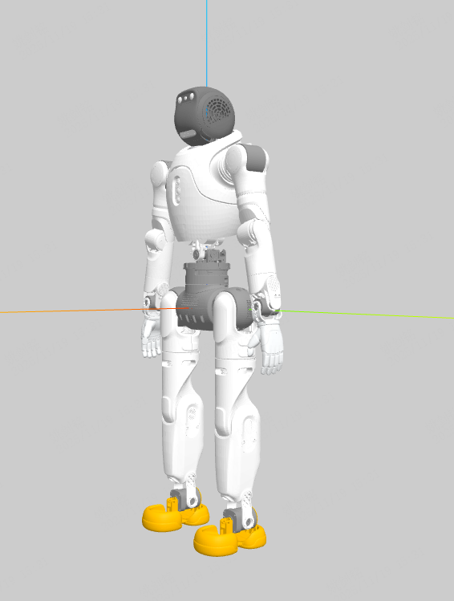
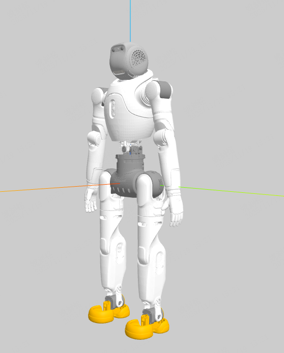
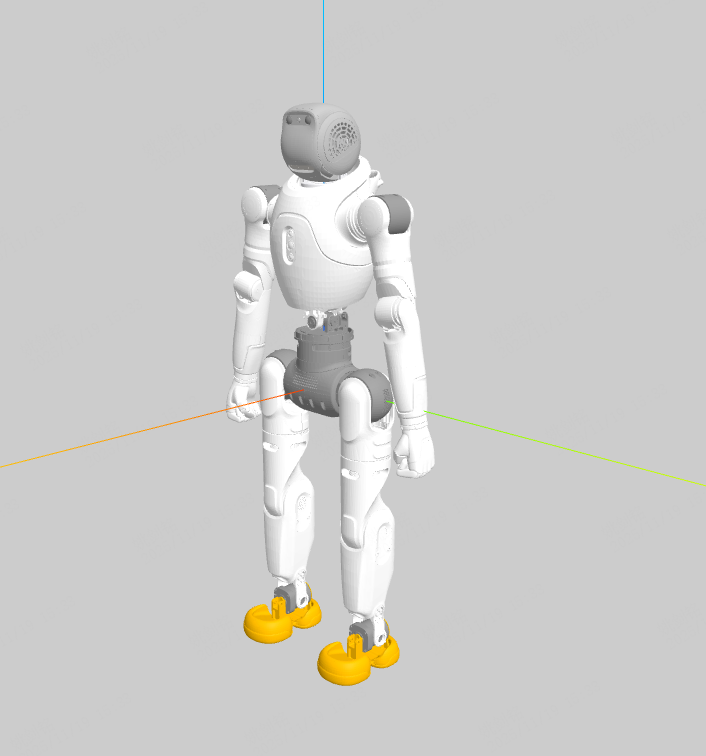

# Robot Model

## 启动 (Launch)

在 RViz 中查看机器人模型：

```bash
# 默认使用 x2_ultra.urdf
ros2 launch x2_description display.launch.py

# 指定其他模型
ros2 launch x2_description display.launch.py urdf:=x2_fist.urdf
ros2 launch x2_description display.launch.py urdf:=x2_hand.urdf
ros2 launch x2_description display.launch.py urdf:=x2_ultra_simple_collision.urdf
```

`urdf` 参数为 `urdf/` 目录下的文件名。

### 可用模型

| 文件 | 说明 |
| --- | --- |
| `x2_ultra.urdf` | 默认模型 |
| `x2_ultra_simple_collision.urdf` | 简化碰撞体 |
| `x2_hand.urdf` | 手爪末端 |
| `x2_fist.urdf` | 拳形末端 |
| `*.xml` / `scene.xml` | MJCF (MuJoCo) 格式 |

## DEBUG工具
### xml && urdf
```
python -m mujoco.viewer
```
* 需要安装mujoco
```
pip install mujoco
```
### urdf
* VScode插件
``` 
# URDF Visualizer
```
## x2_ultra (plus)

## x2_hand (plus)

## x2_fist (plus)

